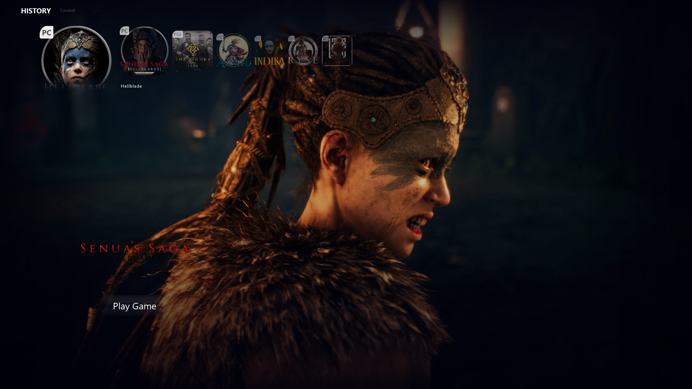
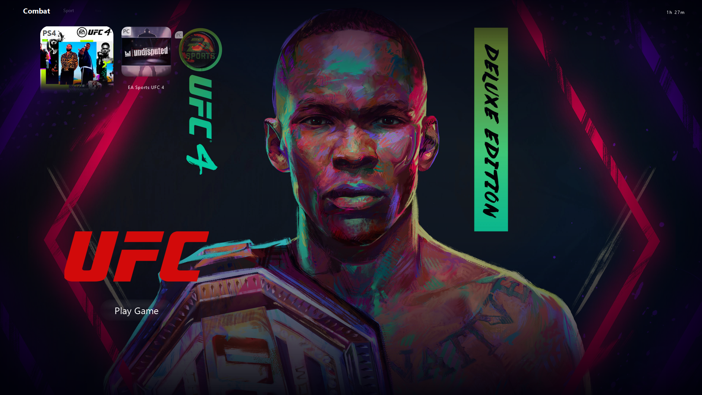

# Astro Launcher

A PS5-styled game **launcher / library front-end** for Windows, built with PyQt6. It does not emulate or stream anything itself — it organizes and launches games you already have installed, through a console-like interface.

## What it actually does

- **Game library scanning** — finds installed games under common launcher folders (Steam, Epic Games, GOG, Origin, EA, Ubisoft Connect, Xbox/Game Pass) and console ROM folders, and launches them directly or via `subprocess`.
- **Optional emulator launching** — if you already have an emulator installed (RPCS3, PCSX2, DuckStation, Ryujinx, Yuzu, Cemu, PPSSPP, Vita3K), you can point a library entry at it with a configurable argument template. The launcher does not bundle, emulate, or reimplement any console hardware itself — it just starts the emulator process you configured, the same way a shortcut would.
- **Metadata & cover art** — looks up title names and box/cover art via IGDB, RAWG, SteamGridDB, and a large built-in title-normalization table (so "GTA V", "GTA 5", "Grand Theft Auto V" all resolve to one canonical entry).
- **Controller support** — reads physical controllers via `hidapi` and remaps/forwards input to a virtual Xbox 360 / DualSense controller via `vgamepad`, with deadzone, sensitivity, and adaptive-trigger/haptic tuning for DualSense pads. It relays and remaps a real connected controller, it does not fabricate input.
- **DualSense Bluetooth audio** — routes controller-speaker/headset audio over the DualSense's Bluetooth HID channel.
- **In-game FPS/CPU/GPU overlay** — a lightweight Tk-based overlay (packed inside the script and extracted at runtime) showing live performance stats.
- **"Booster" tweaks** — optional, reversible Windows-level adjustments before launching a game: process priority/affinity, power plan, disabling Game DVR, etc.
- **Save backups, mods/DLC/patch tracking, trainer launching** — per-game metadata and housekeeping, not gameplay modification by this app itself.
- **Config export** that automatically redacts sensitive fields (tokens, secrets, API keys) before sharing a diagnostic file.

## Screenshots

| Library / history view | Game detail view |
|---|---|
|  |  |

Games are grouped into rows by category (History, Combat, Sport, …), each tile shows its platform badge (PC/PS4/etc.), and selecting a game shows full-bleed art with a "Play Game" prompt and session playtime — the PS5-style shell described above.

## Project layout

```
ps5_launcher.py       # main application source
ps5_launcher.spec     # PyInstaller build spec (onedir Windows build)
requirements.txt      # Python dependencies
icon.ico, tray-icon.png, 1117123.png   # app/tray icons and artwork
hidapi.dll, hidapi.lib                 # native HID bindings used by the build
```

## Building from source (Windows)

```powershell
python -m venv .venv
.venv\Scripts\activate
pip install -r requirements.txt
pyinstaller ps5_launcher.spec
```

The build output is a portable `PS5-Launcher` folder under `dist/` (onedir build, so native DLLs and Qt plugins stay next to the executable).

## Automated builds

A GitHub Actions workflow (`.github/workflows/build.yml`) builds the Windows executable on every push to `main` and uploads it as a downloadable artifact — check the **Actions** tab, or trigger it manually from there.

## Requirements

- Python 3.13+
- Windows 10/11 (PyQt6 + `hidapi` + `vgamepad` are Windows-oriented)
- Any emulators you want to launch through it must be installed and configured separately — none are included.
